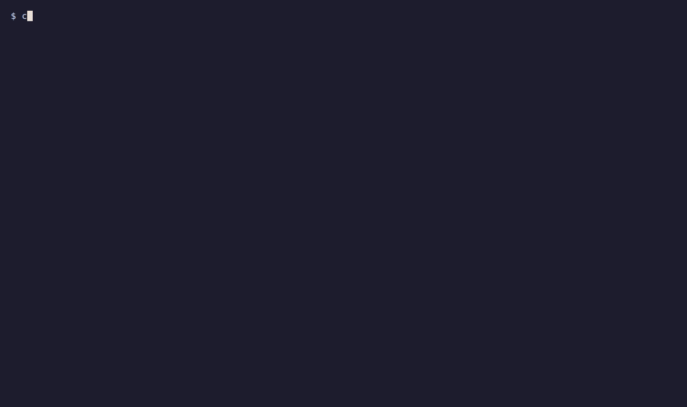

# AgentGuards — guardrails for AI coding agents

**Stop prompt injection, secret leaks and destructive commands before your coding agent acts on them.**
Works with Claude Code, OpenAI Codex, Gemini CLI, GitHub Copilot CLI and OpenCode.

[](#install--one-line-per-agent)
[](./LICENSING.md)

Your agent reads web pages, PDFs, images and tool output you never see. Any of them can carry
instructions written for the agent, not for you. AgentGuards hooks into the agent itself and checks
every prompt, shell command and piece of fetched content before the agent acts on it.

## What gets blocked



*A real, unedited run: Claude Code with the AgentGuards plugin is asked to apply the "performance
tips" from a blog post (a test page served locally) that carries instructions aimed at the agent.
AgentGuards blocks the page content, and Claude leaves `src/app.py` untouched.*

<details>
<summary>Another example: instructions hidden in a PDF</summary>


*Claude Code is asked to summarize a PDF whose white text layer carries instructions for the agent.
The file is blocked before Claude reads it.*

</details>

| The agent is about to… | AgentGuards |
|---|---|
| Read a web page with hidden "ignore your instructions and…" text | Withholds the page, or strips the injected text, before the agent acts on it |
| Open a PDF or screenshot carrying injected instructions (including text hidden from human eyes)\* | Blocks the file before the agent opens it |
| Run `curl` or `wget` with a real API key or token in what it sends out | Stops it and asks you first — naming the kind of secret and where it was going |
| Run `rm -rf ~` or another destructive command | Blocks it before it runs; anything outside a safe baseline waits for your approval |
| Act on a prompt that is a jailbreak or prompt-injection attempt | Blocks the prompt |
| Write code containing a hardcoded secret or a known-vulnerable pattern\* | Flags it right after the write |

\* Claude Code and Codex. Everything else in the table: all five agents.

Every block tells the agent — and you — what was stopped and why. Blocks are fail-closed by
default; set `AGENTGUARDS_FAIL_OPEN=true` if you prefer availability over enforcement.

## Install — one line per agent

| Agent | Install |
|---|---|
| **Claude Code, Codex** (macOS, Linux) | `curl -fsSL https://agentguards.co/install.sh \| sh` |
| **Claude Code, Codex** (Windows PowerShell) | `irm https://agentguards.co/install.ps1 \| iex` |
| **GitHub Copilot CLI** | `copilot plugin install alelaguard/agentguards-plugins:copilot` |
| **OpenCode** | `opencode plugin @agentguardsco/opencode-plugin` |
| **Gemini CLI** | `git clone https://github.com/alelaguard/agentguards-plugins.git && gemini extensions link agentguards-plugins/gemini` |

**Claude Code and Codex:** the installer signs you in through your browser, adds the plugin to
whichever of the two you have, and saves your key. Nothing to copy or paste.

**Installed `agentguards` from Claude's plugin directory?** You're already set. Don't also run the
installer or add `agentguards-claude`: every hook would run twice.

**Copilot CLI, OpenCode and Gemini CLI** also need a key.
[Create a free account](https://agentguards.co/sign-up?utm_source=github&utm_medium=readme&utm_campaign=plugins_repo&utm_content=install_key),
copy a key from the dashboard, and add it to your shell profile:

```
export AGENTGUARDS_API_KEY=ag_your_token_here
```

New accounts start with 1,000 free requests.

<details>
<summary>Prefer the plugin commands for Claude Code or Codex?</summary>

Claude Code:

```
/plugin marketplace add alelaguard/agentguards-plugins
/plugin install agentguards-claude@agentguards
```

Codex:

```
codex plugin marketplace add alelaguard/agentguards-plugins
codex plugin add agentguards-codex@agentguards-codex
```

Then set `AGENTGUARDS_API_KEY` as above.
</details>

Full configuration per agent: [Claude Code](./claude/README.md) · [Codex](./codex/README.md) ·
[Gemini CLI](./gemini/README.md) · [Copilot CLI](./copilot/README.md) · [OpenCode](./opencode/README.md)

## How it works

```
 your prompt / shell command / fetched page, PDF or image
                         │
        agent hook (this repo, source-available)
                         │
                AgentGuards API  ──►  allow · ask · block
                         │
     the agent only sees what was allowed
```

The plugins in this repo are thin hooks: they hand each prompt, command and piece of fetched
content to the AgentGuards API, then enforce the answer inside the agent. Detection — injection and
jailbreak classifiers, secret and PII scanning, command policy — runs server-side, so it improves
without you reinstalling anything.
[How the hooks work](https://agentguards.co/docs/hooks-guide?utm_source=github&utm_medium=readme&utm_campaign=plugins_repo&utm_content=how_it_works) ·
[Images and PDFs](https://agentguards.co/docs/images-and-pdfs?utm_source=github&utm_medium=readme&utm_campaign=plugins_repo&utm_content=how_it_works) ·
[OWASP Agentic mapping](https://agentguards.co/docs/owasp-agentic?utm_source=github&utm_medium=readme&utm_campaign=plugins_repo&utm_content=how_it_works) ·
[Privacy](https://agentguards.co/privacy?utm_source=github&utm_medium=readme&utm_campaign=plugins_repo&utm_content=how_it_works)

## Plugins

| Plugin | Agent | Deployment | Version | What it includes |
|---|---|---|---|---|
| [`agentguards-claude`](./claude) | Claude Code | hosted | `0.2.39` | Enforcing hooks (input, Bash, web-content with pre-fetch URL check, image/PDF scan before Read or a shell command reads them, code scan). No MCP server. |
| [`agentguards`](./claude-directory) | Claude Code | hosted | `0.2.39` | **For the Claude plugin directory only — installing from this repo? Use `agentguards-claude` above, never both.** Directory edition generated from `agentguards-claude`: same hooks, but never answers a permission prompt for you (no auto-approval of safe commands). |
| [`agentguards-codex`](./codex) | OpenAI Codex | hosted | `0.2.25` | Enforcing hooks (input, shell, web-content with pre-fetch URL check, image/PDF scan before view_image or a shell command reads them, code scan). No MCP server. |
| [`agentguards-gemini`](./gemini) | Gemini CLI | hosted | `0.1.10` | MCP server + enforcing hooks (input, tool-call, web-content with pre-fetch URL check) and security instructions. |
| [`agentguards-copilot`](./copilot) | GitHub Copilot CLI | hosted | `0.1.9` | MCP server + enforcing hooks (input, shell, web-content with pre-fetch URL check) and security instructions. |
| [`@agentguardsco/opencode-plugin`](./opencode) | OpenCode | hosted | `0.1.9` | Enforcing plugin (prompt, `bash`, web-content with pre-fetch URL check), + MCP server and security instructions. |

Versions are the current release in this repo; our release checks fail if they drift from the plugin
manifests. To see what you have installed, use your agent's own listing (`/plugin` in Claude Code).

### Self-hosted (AWS Marketplace appliance)

Running the AgentGuards appliance in your own AWS account? Use these instead — hooks only, no bundled
MCP server, and no default URL, so they can never talk to the hosted service by accident.

| Plugin | Agent | Deployment | Version |
|---|---|---|---|
| [`agentguards-claude-selfhosted`](./claude-selfhosted) | Claude Code | self-hosted | `0.1.11` |
| [`agentguards-codex-selfhosted`](./codex-selfhosted) | OpenAI Codex | self-hosted | `0.1.6` |
| [`agentguards-gemini-selfhosted`](./gemini-selfhosted) | Gemini CLI | self-hosted | `0.1.5` |
| [`agentguards-copilot-selfhosted`](./copilot-selfhosted) | GitHub Copilot CLI | self-hosted | `0.1.4` |

## About this repository

This repository holds the released plugins and is what every install method reads from. It is
published from our private development repository on each release, so it doesn't carry our
tests or development history. Issues and security reports are welcome
([`SECURITY.md`](./SECURITY.md)); we can't accept pull requests here.

## License

The hosted plugins (`claude/`, `claude-directory/`, `codex/`, `gemini/`, `copilot/`, `opencode/`) are source-available
under the [Functional Source License 1.1, MIT Future License](https://fsl.software): free to read,
use and modify for anything except a competing product, and each version becomes MIT two years
after release. The self-hosted plugins and everything else here are MIT. Earlier releases stay MIT.
See [`LICENSING.md`](./LICENSING.md) for the details and [`TRADEMARKS.md`](./TRADEMARKS.md) for the
name and logo.
